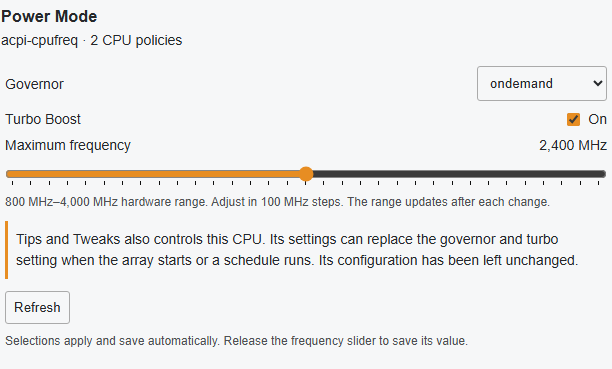

# Dashboard Power Mode (Unraid Plugin)

An Unraid plugin that brings **Power Mode controls to the dashboard**, with governor selection, a Turbo Boost checkbox, and a maximum CPU frequency slider adapted to your hardware.

Repository: https://github.com/johnngone/dashboard-power-mode-unraid



Illustrative preview using synthetic CPU data.

## Installation

Requires **Unraid 7.0 or newer**. Community Applications listing is not currently available.

### Via Manual Install

From the Unraid Web UI:

**Plugins → Install Plugin**, then paste:

```text
https://raw.githubusercontent.com/johnngone/dashboard-power-mode-unraid/main/plugin/dashboard-power-mode.plg
```

### Usage

Open **Dashboard** and find the **Power Mode** card. If hidden, enable it in the dashboard's content manager.

- Select a governor directly.
- Check or uncheck **Turbo Boost** and move the **Maximum frequency** slider as needed.
- Selections apply and save automatically. Each control changes only its own setting.
- The frequency slider has a notch every **100 MHz**, previews while dragging, and saves once released rather than sending requests for every movement. Its limits and notches refresh after every saved change.
- **Refresh** reads the live settings. Live values also refresh every ten seconds when you are not editing.

The initial installation leaves CPU settings unchanged. Successfully selected values are saved to `/boot/config/plugins/dashboard-power-mode/settings.json` and restored during plugin installation at boot. Only controls you have changed are managed; unsupported controls are disabled. Controls briefly disable while a change is saving; there are no concurrent save requests or added background services.

The displayed frequency ceiling is what the kernel accepted, rather than a guarantee of instantaneous clock speed. Hardware rounding, turbo restrictions, thermal limits, and firmware can lower the effective frequency. Turbo off may lower the effective cap and slider range even if a higher ceiling was requested. The plugin waits for delayed CPUFreq limit updates and preserves your CPU minimum frequencies; changes that would alter those minimums are rejected and rolled back.

## What This Plugin Does

- Adds a native dashboard tile without patching Unraid's core files.
- Discovers CPUFreq policies and exposes governors supported by every policy.
- Uses Intel `no_turbo`, global CPUFreq `boost`, or per-policy boost interfaces when available.
- Applies one frequency ceiling within a range valid across all CPU policies.
- Validates requests, uses Unraid web authentication and CSRF protection, serializes writes, verifies readback, and attempts rollback if a change fails.
- Embeds the complete payload in the `.plg`, so reboot installation needs no network download or extra package.
- Supports updates and removal through **Plugins**. Removal retains saved configuration and leaves current CPU settings in place until changed or rebooted.

### Hardware Compatibility

Designed for Unraid 7.x on machines exposing Linux CPUFreq controls. Available governors, frequency ranges, and turbo controls depend on the CPU, scaling driver, BIOS, and virtualization. The plugin does not alter BIOS settings, load drivers, write MSRs, or force unsupported capabilities. The checkbox shows an indeterminate state if CPU policies initially disagree, and is disabled if turbo control is unavailable. Slider steps are rounded inward to keep every selection inside the current hardware limits. A `userspace` governor requires an external frequency controller; this plugin does not set a fixed userspace speed.

Live-tested on a physical Unraid server with Intel CPUFreq. See [VALIDATION.md](VALIDATION.md) for coverage. Other hardware receives simulated coverage only. Hardware detection is performed locally; the repository contains no server configuration export, and the screenshot uses synthetic data.

### Tips and Tweaks / Other CPU Managers

**Tips and Tweaks is left unchanged.** The card warns when its CPU overrides or schedules are configured. Tips and Tweaks can overwrite the governor and turbo setting when the array starts, when its settings are applied, or when schedules run. Unraid's native Power Mode page and user scripts can also change the governor. The card shows those live changes; it does not continuously enforce saved settings or fight other CPU managers.

For a single source of CPU control, disable competing overrides yourself. This plugin does not automatically modify or uninstall another plugin.

### Development

Editable payloads are in `src/`. Build the self-contained installer with Python 3.9+:

```bash
python build.py
python build.py --check
python tests/manifest.py
python tests/privacy.py
php tests/power-control.php
node --check src/javascript/power-mode.js
python -m pip install -r requirements-dev.txt
python -m playwright install chromium
python tests/dashboard.py
```

CI checks packaging, embedded checksums, syntax, and simulated Intel / AMD controls, unsupported hardware, mixed policies, validation, persistence, locking, and rollback. Browser checks verify automatic saving, one request per slider release, unchanged-value no-ops, and error recovery. PHP 8.0+ is required for development; CI uses PHP 8.2. The browser development dependency is not installed on Unraid or included in the plugin.

## License

GPL-2.0-only. See [LICENSE](LICENSE).
